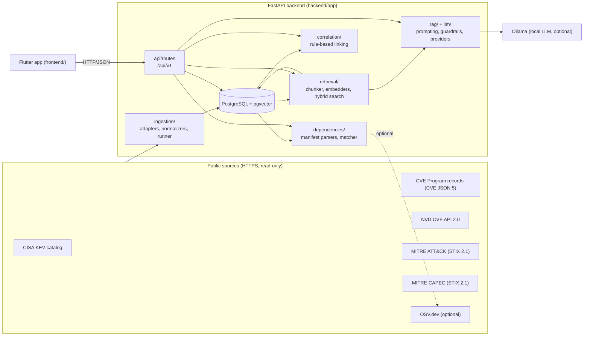
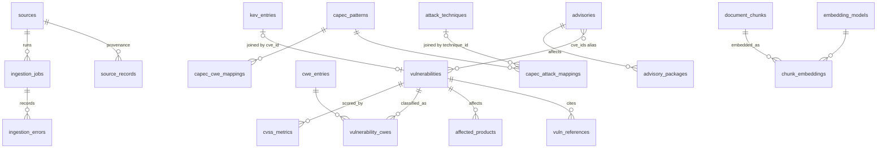
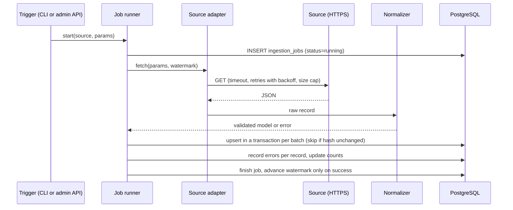
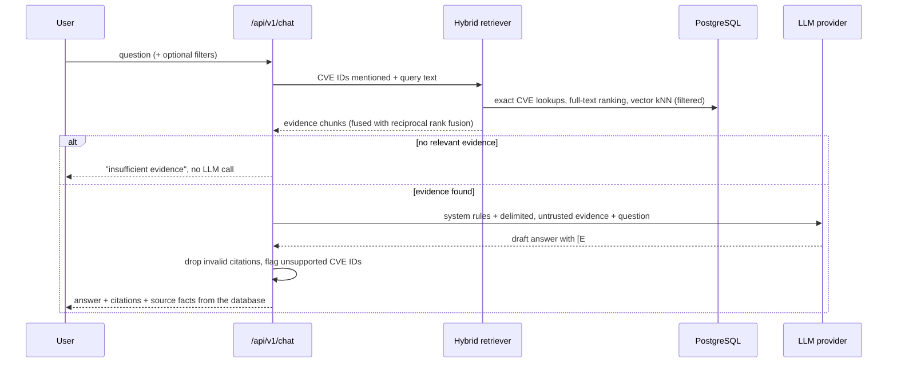
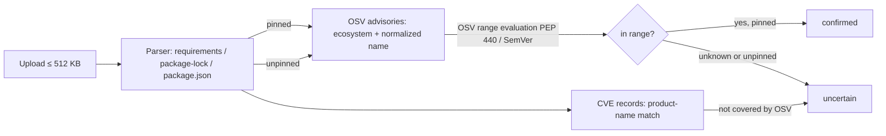

# Architecture

This document describes the system as implemented. `docs/IMPLEMENTATION_STATUS.md` records
what was verified and how.

## 1. Overview

The platform is a **modular monolith**: one FastAPI codebase with clear internal modules,
backed by one PostgreSQL database (with the pgvector extension) and an optional local LLM
served by Ollama. A Flutter client talks to the REST API only.

## 2. Component boundaries

| Module | Responsibility | Must not |
|---|---|---|
| `app/api/routes` | HTTP concerns: request validation, status codes, response schemas, auth dependencies | Contain business logic or SQL |
| `app/services` | Read-side query logic for vulnerabilities, KEV, techniques, sources and stats | Know about HTTP |
| `app/ingestion` | Fetch, validate, normalize and upsert source data; job lifecycle | Be triggered without a job record |
| `app/retrieval` | Build documents and chunks, compute embeddings, hybrid search | Call the LLM |
| `app/llm` | Provider abstraction (Ollama, OpenAI-compatible, mock, none) | Contain prompts for a specific feature |
| `app/rag` | Evidence selection, prompt construction, citation validation, fallbacks | Write to the database |
| `app/correlation` | Explainable links between CVEs, KEV, CWE, CAPEC and ATT&CK | Store inferred links as facts |
| `app/dependencies` | Parse manifests without executing them; match packages to vulnerability data | Execute or install anything |
| `app/core` | Configuration, logging, errors, security helpers, rate limiting | Depend on feature modules |
| `app/db` | Engine, sessions, ORM models | Contain feature logic |

## 3. Data sources and why they were chosen

| Source | Used for | Access path | Notes |
|---|---|---|---|
| CISA KEV | Known-exploited status, required action, due dates, ransomware use, CWEs | `cisagov/kev-data` on GitHub (official CISA mirror) or `cisa.gov` feed | One JSON file, about 1,700+ entries |
| CVE Program (CVE JSON 5) | Authoritative CVE records: description, CNA and CISA-ADP CVSS, CWEs, affected products and versions, references | `CVEProject/cvelistV5` on GitHub, one file per CVE | Also has `deltaLog.json` for incremental refresh |
| NVD CVE API 2.0 | NVD analysis: CVSS, CWE, CPE configurations | `services.nvd.nist.gov` | Optional API key raises rate limits; enrichment, not required |
| MITRE ATT&CK Enterprise | Techniques, tactics, platforms | `mitre-attack/attack-stix-data` on GitHub | STIX 2.1 bundle, about 55 MB |
| MITRE CAPEC | Attack patterns with their published CWE and ATT&CK mappings | `mitre/cti` on GitHub | Basis of the CWE→CAPEC→ATT&CK chain |
| OSV.dev | Ecosystem-exact package vulnerability matching | `api.osv.dev` | Optional and off by default, because it sends package names to a third party |

Only these hosts are contacted (an allowlist enforced in `app/ingestion/http.py`).
Reference URLs found inside records are stored as data and never fetched.

## 4. Database design

Migrations:
- `0001_initial`: the core schema, the `vector` extension and the `sources` rows;
- `0002_job_details_cvss_rank`: job details and CVSS provider rank;
- `0003_osv_advisories`: OSV advisory tables.

Principles:

* **Official vs derived data.** Tables mirror what sources state, with the provider recorded
  on every score, CWE and affected-product row. Derived values are limited to:
  - a cached display severity on `vulnerabilities`, chosen by a documented precedence rule;
  - document chunks and embeddings.

  Correlations are computed at query time with named rules and are never stored as facts.
* **Idempotency.** Every source record has a natural key (CVE ID, KEV CVE ID, STIX ID,
  CAPEC ID). Writes are upserts. A SHA-256 content hash per source record lets unchanged
  records be skipped and counted as `unchanged`.
* **Multiple providers.** CVSS and CWE rows are keyed by `(vulnerability, ingest_source,
  provider, …)`. Re-ingesting NVD only replaces NVD rows and never overwrites CNA data.
* **KEV is independent of CVE ingestion.** `kev_entries.cve_id` is not a foreign key, so the
  KEV catalog can be loaded before (or without) the full CVE record.
* **One running job per source**, enforced by a partial unique index on `ingestion_jobs`.
* **Vectors.** `chunk_embeddings.embedding` is `vector(768)` with an HNSW cosine index. The
  dimension is fixed by migration. Changing to a model with another dimension requires a new
  migration and re-embedding.

Display severity precedence (documented in `app/ingestion/normalize.py`):
1. CNA scores first, then NVD primary, then CISA-ADP.
2. Within a provider: CVSS v3.1, then v3.0, then v4.0, then v2.0.

v3.x is preferred because it is the most widely populated version, which keeps filters
comparable across records.

## 5. Ingestion pipeline

* Malformed records are logged to `ingestion_errors`. They are skipped without aborting the
  job.
* Transient failures (timeouts, 429, 5xx) are retried with exponential backoff and jitter,
  and `Retry-After` is honoured. Other errors fail fast.
* If a source is unreachable, its job fails and the previously ingested data stays
  available, so the API keeps working.

## 6. Retrieval and RAG

* Facts (CVSS, KEV status, CWE) shown with an answer come from the database, not the model.
* If the LLM is unavailable or times out, the API returns the retrieved evidence with
  `mode = "evidence_only"` instead of failing.

Retrieval details (`app/retrieval/search.py`):

* **Keyword list.** Any-term full-text matching over chunk `tsvector`s, using
  English-stemmed prefix lexemes. Results are ranked by the summed IDF of the matched
  terms (document frequencies come from `ts_stat` and are cached), and `ts_rank_cd`
  breaks ties.
* **Vector list.** Cosine distance for the configured model. The scan is exact up to
  20,000 vectors; above that the HNSW index is used, with `ef_search=200`. The embeddings
  job keeps one model per index so the approximate search stays accurate.
* **Fusion.** Reciprocal rank fusion with k=60. A lexical embedder's list carries weight
  0.02, so it only breaks ties; a semantic model's list carries weight 1.0.
* **Relevance gate for RAG.** A chunk counts as evidence only if it is one of the CVEs
  the question names, covers at least 50% of the question's IDF weight, or (with a
  semantic model) lies within cosine distance 0.55.

## 6a. Dependency analysis

## 7. Security model (summary)

* Public endpoints are read-only and unauthenticated. Admin endpoints need `X-Admin-Key`,
  compared in constant time, and are disabled when no strong key is configured.
* Requests are validated with Pydantic, with bounded pagination, query lengths and upload
  sizes.
* All SQL goes through SQLAlchemy with bound parameters.
* External content is treated as untrusted data:
  - escaped inside prompts;
  - rendered as text in the UI;
  - never fetched from links it contains.
* Credentials are masked in logs, and clients never receive stack traces.

Details: `docs/security.md`.

## 8. Testing strategy (summary)

* **Unit tests:** no network and no database. External HTTP is mocked with
  `httpx.MockTransport`.
* **Integration tests:** a real PostgreSQL with pgvector, selected with `TEST_DATABASE_URL`.
  Tables are truncated between tests.
* **RAG tests:** use a deterministic mock LLM.
* **Evaluation scripts** (`backend/eval/`) measure retrieval and matching against a labelled
  set, and are run against ingested data.

Details: `docs/testing.md`.
